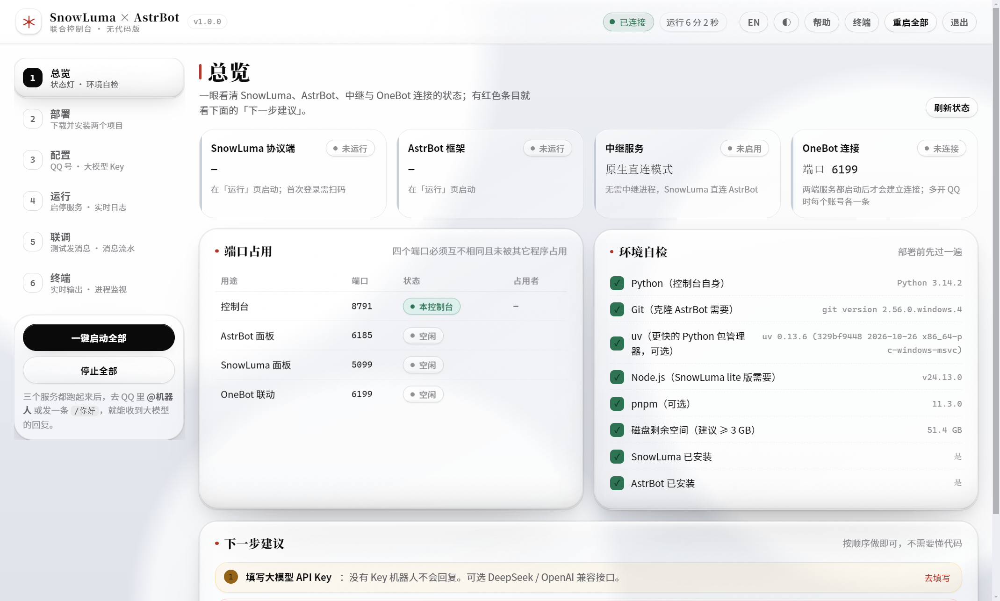

# SnowLuma × AstrBot 联合控制台

> 在 Windows 上**点几下鼠标**，把 [SnowLuma](https://github.com/SnowLuma/SnowLuma)（QQ 协议端）和
> [AstrBot](https://github.com/AstrBotDevs/AstrBot)（大模型机器人框架）装好、连起来，
> 然后在 QQ 里和你自己的 AI 机器人聊天 —— **不用敲命令、不用改配置文件**。

```
版本 v1.7.2   ·   Windows 10/11 x64   ·   桌面版(Electron) / 浏览器版   ·   MIT
```



---

## 目录

- [这是什么](#这是什么)
- [功能一览](#功能一览)
- [快速开始（3 步）](#快速开始3-步)
- [窗口怎么操作（关闭是长按）](#窗口怎么操作关闭是长按)
- [工作原理](#工作原理)
- [两种联动模式](#两种联动模式)
- [常见问题](#常见问题)
- [文档](#文档)
- [目录结构](#目录结构)
- [命令行与二次开发](#命令行与二次开发)
- [打包 exe](#打包-exe)
- [许可与免责声明](#许可与免责声明)

---

## 这是什么

它把两个本来要命令行操作的开源项目，包成一个**能点着用的桌面程序**：

| 组件 | 角色 | 默认端口 |
| --- | --- | --- |
| **SnowLuma** | 接管你已登录的 QQ，转成 OneBot v11 接口 | 面板 5099 / OneBot 3000·3001 |
| **AstrBot** | 收消息 → 问大模型（DeepSeek / OpenAI 兼容）→ 回消息，可装插件 | 面板 6185 / 反向 WS 6199 |
| **本控制台** | 装、配、启停、连通、排错、升级 | 8790 |

四件事：**下载安装** → **可视化配置** → **一键启停 + 实时日志** → **联调自检（真发一条消息验证）**。

---

## 功能一览

| 能力 | 说明 |
| --- | --- |
| **四步向导** | 环境检查 → 一键装两个项目 → 填 QQ 号/Key → 启动；装完填完不再打扰 |
| **一键安装** | 自动下发行包 / 克隆源码 / 建独立 venv / 装依赖，全程静默无黑框 |
| **登录 QQ** | 「用这个」只注入你选中的 QQ 进程；也能**隔离启动**一个独立数据目录的 QQ 分身 |
| **大模型配置** | 拉取该 Key 可用的模型列表（下拉选）、真发一次请求测连通性、从 AstrBot 读回实际生效配置 |
| **双向自检** | 四步逐条：连接 → 面板登录 → API Key → **真发一条消息到 QQ**；哪步红修哪步 |
| **一键修复发送链路** | 机器人「能收不能发」时点它：切中继模式 → 起服务 → 验证发送 |
| **面板免翻日志** | 直接显示两个面板的密码，可复制、一键登录；忘了能**重置密码** |
| **液态玻璃 UI** | 无边框窗口、深/浅双主题、中英双语 |
| **启动/退出干净** | 启动清理上次残留进程；退出停服务 + 清进程 + 释放端口，关窗即退出 |
| **默认不占 C 盘** | 自动挑非系统盘放数据/安装/缓存；只有一块盘时才用 C |
| **从 zip 升级** | 配置页「升级控制台」：备份 → 覆盖 → 重启，失败自动回滚；配置自动迁移 |
| **运维工具** | 端口避让、日志保留天数、清理残留进程、卸载/彻底删除、配置导出导入 |

---

## 快速开始（3 步）

1. **解压** `SnowLuma-Desktop-v…-win-x64.zip`，双击 `SnowLuma-Desktop.exe`
2. 跟着**四步向导**：环境检查 → 装两个项目 → 填**机器人小号** QQ 号 + 大模型 API Key → 启动
3. 「运行 → 接入 QQ」点 **用这个** 注入机器人小号；然后私聊或群里 @ 它

> 群里不回 / 插件不触发 → 「联调」页点 **双向自检**；多数是 native 模式的发送链路问题，点「修复发送链路」一键切中继。

---

## 窗口怎么操作（关闭是长按）

没有系统标题栏，**顶栏就是标题栏**（按住可拖动窗口）。右上角：

| 按钮 | 图标 | 操作 | 效果 |
| --- | --- | --- | --- |
| 最小化 | `—` | 单击 | 收进任务栏，服务继续跑 |
| 最大化/还原 | `▢` | 单击（或双击顶栏空白） | 全屏 / 还原 |
| 置顶 | `◎` | 单击 | 窗口常在最前 |
| **电源键** | `⏻` | **按住 1 秒**（外圈进度环画满） | 弹出「收起窗口 / 彻底退出」 |

- **收起窗口**：服务继续跑，机器人不掉线（日常推荐）
- **彻底退出**：停服务 + 清残留进程 + 释放端口
- `Ctrl+Q` = 同一菜单；`Alt+F4` 先停服务再关窗；卡住有 9 秒强制退出兜底

---

## 工作原理

```
QQ 客户端（小号登录）
      │  SnowLuma 注入进程，接管会话
      ▼
  SnowLuma  ──OneBot v11──►  AstrBot  ──HTTP──►  大模型（DeepSeek/OpenAI 兼容）
   面板 5099                  面板 6185
      │                          │
      └──────── 本控制台 8790：启停 / 配置 / 日志 / 自检 / 升级 ────────┘
```

---

## 两种联动模式

| 模式 | 链路 | 适用 |
| --- | --- | --- |
| **native（直连）** | SnowLuma ⭢ AstrBot | 少一跳；但 AstrBot 的 aiocqhttp 重连后易丢失"可发送的 bot"，表现为**能收不能发** |
| **bridge（中继，推荐）** | SnowLuma ⇄ 内置中继 ⇄ AstrBot | 全双工客户端，**私聊 / 群聊 / 图片 / 文件 / @ 全部支持**，插件动作原样透传 |

---

## 常见问题

| 现象 | 处理 |
| --- | --- |
| 能收到消息但不回 / 群聊不回 | 联调页「双向自检」→「修复发送链路」（切中继） |
| 插件不触发 | AstrBot 面板确认插件已启用；前缀默认 `/`；发送链路正常 |
| `401 API Key 无效` | 配置页「测试大模型连接」按提示换 Key / Base URL |
| `端口 6185 已被占用` | 配置页「清理残留进程」；重启会自动先清 |
| 一键登录密码错误 | 「运行 → 面板登录 → 重置密码」 |
| 首次启动慢 / 窗口"未响应" | 杀软扫描 + 首次解压，等 10 秒；日常用「收起窗口」 |
| 关窗后还有进程 | 升级到当前版本；配置页「清理残留进程」 |

详见 [docs/MANUAL.md](docs/MANUAL.md) 与 [docs/TROUBLESHOOTING.md](docs/TROUBLESHOOTING.md)。

---

## 文档

| 文档 | 内容 |
| --- | --- |
| [docs/MANUAL.md](docs/MANUAL.md) | **操作手册**：装、登录 QQ、配置、联动、插件命令、维护、故障速查 |
| [docs/UPGRADE.md](docs/UPGRADE.md) | **升级指南**：版本规则、三种升级方式、回滚 |
| [docs/DEPLOY.md](docs/DEPLOY.md) | 部署细节：下载源、版本、目录、端口 |
| [docs/TROUBLESHOOTING.md](docs/TROUBLESHOOTING.md) | 故障树与逐项排查 |
| [docs/ARCHITECTURE.md](docs/ARCHITECTURE.md) | 架构与数据流 |
| [docs/CONTRACTS.md](docs/CONTRACTS.md) | 与两个项目的接口契约 |
| [CHANGELOG.md](CHANGELOG.md) | 更新日志（语义化版本） |

---

## 目录结构

```
snowluma-astrbot-console/
├─ slab/                 控制台后端（FastAPI）
│  ├─ installer.py       下载/校验/解压/克隆/建 venv/卸载
│  ├─ supervisor.py      服务启停（进程树、端口预检、退出清理）
│  ├─ envcheck.py        环境自检（并行探测 + 磁盘缓存 + 端口表）
│  ├─ bridge.py          OneBot 中继（Universal 客户端，全双工）
│  ├─ sources.py         下载源目录与测速
│  ├─ orphans.py         残留进程识别与清理
│  ├─ migrations.py      配置版本迁移
│  ├─ upgrade.py         从 zip 升级（助手进程 + 回滚）
│  ├─ server/            HTTP 路由（console/deploy/link/qq/upgrade）
│  └─ web/               前端（原生 JS + CSS，无构建、无 CDN）
├─ desktop/              Electron 外壳（无边框窗口 + 长按电源键）
├─ packaging/            PyInstaller 打包脚本与 spec
├─ tests/                pytest（365 项）
├─ docs/                 文档与截图
├─ vendor/sandbox/       QQ 分身注入组件
└─ VERSION               版本号唯一来源
```

运行期目录（默认不在 C 盘）：

```
<盘符>:\SnowLumaAstrBot\
├─ data\        配置、日志、备份、升级缓存
├─ runtime\     snowluma / astrbot 的实际安装
└─ downloads\   安装包缓存
```

---

## 命令行与二次开发

```bat
:: 启动控制台（源码模式）
.venv\Scripts\python.exe -m slab serve --port 8790

:: 跑测试
.venv\Scripts\python.exe -m pytest -o addopts="" -q

:: 版本号（同步 VERSION / package.json / CHANGELOG）
scripts\bump.ps1 patch|minor|major "说明"
```

常用环境变量：`SLAB_DATA_DIR` / `SLAB_RUNTIME` / `SLAB_DOWNLOAD_DIR` / `SLAB_STORAGE_ROOT` /
`SLAB_LANG=en` / `SLAB_THEME=dark` / `SLAB_SNOWLUMA_HOOK_AUTOLOAD=1`。

---

## 打包 exe

```bat
packaging\build-exe.bat        :: 控制台（浏览器版）→ dist\*.zip
desktop\build.bat             :: 桌面版（Electron）→ desktop\dist\*.zip
```

两个脚本都带版本号生成 zip；桌面版打包前有**冒烟测试**（启动 → 关窗 → 检查后端是否被回收）。

---

## 许可与免责声明

- 本控制台代码：MIT
- 集成 [SnowLuma](https://github.com/SnowLuma/SnowLuma)、[AstrBot](https://github.com/AstrBotDevs/AstrBot)，遵循各自上游许可
- **协议端有封号风险**：请使用**小号**，不要用主号挂机器人；账号风险由使用者自负
- 本项目只做本地集成与可视化，不代理、不上传聊天内容；大模型请求直连你配置的服务商
